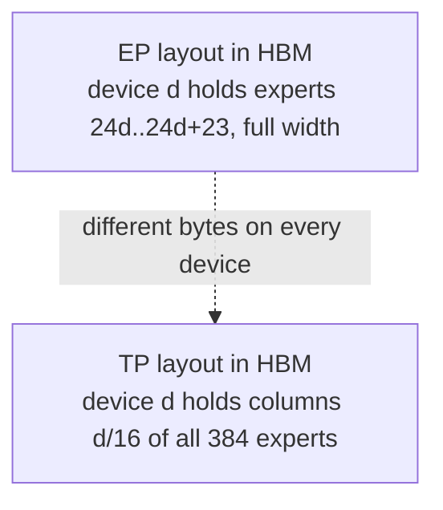

# MoE EP vs MoE TP at low concurrency — stupidly simple version

## 1. What is "low concurrency" and why is it a different world

"Concurrency" = how many requests are being decoded at once. Each decode step
produces **one token per request**. With DP=16 engines, concurrency C means
each device sees `C / 16` tokens per step.

| C (requests) | tokens per device per step | tokens in the whole MoE layer |
|---|---|---|
| 16 | 1 | 16 |
| 64 | 4 | 64 |
| 256 | 16 | 256 |
| 2048 | 128 | 2048 |

At decode, each token does very little math. What costs time is **reading
expert weights from HBM**. An expert in DSV4-Pro (fp4, hidden 7168,
inter 3072) is ~33 MB. Reading it takes ~4.5 us at 7.4 TB/s. Doing the
matmul for *one* token against it is essentially free.

> **Key idea**
> - **High concurrency**: time ~ compute + network volume -> you want the big
>   dense matmuls EP gives you.
> - **Low concurrency**: time ~ `max over devices (bytes of expert weights that
>   device must read)` -> you want every device to read the **same** amount.
>
> That single difference is the whole story.

## 2. Toy example: 4 devices, 8 experts, top-2, one token per device

Each expert weighs **W** bytes. Token picks (skewed on purpose, like real
routing with hot experts):

```
token A -> experts {0, 1}
token B -> experts {0, 2}
token C -> experts {1, 7}
token D -> experts {0, 5}
```

Experts hit: {0,1,2,5,7} -> 5 of 8.

### EP (each device owns 2 whole experts)


### TP (each device owns 1/4 of **every** expert)


Total bytes read across the cluster are **identical** (5W). TP just spreads
them evenly, so the straggler disappears. EP is 2W / 1.25W = **1.6x slower**
here.

### Same toy at "high concurrency" (say 100 tokens)

Now all 8 experts are hit on every step. EP: every device reads 2W. TP: every
device reads 8 x W/4 = 2W. **Weight reading is a tie.** What's left is:

- EP: big matmuls (each device does *all* rows for its 2 experts, full width)
  + one all-to-all of token rows.
- TP: thin matmuls (every device does *every* row at 1/4 width) + a 4-way
  all-reduce of **every** output row.

EP wins. That is why the fused-EP kernel is +42% at C=2048 on DSV4-Pro.

## 3. Put DSV4-Pro numbers in (384 experts, top-6, 16 devices, 24 experts/device)

Assume uniform routing (real routing is skewier, which makes EP look *worse*,
not better). Picks per step = `tokens x 6`. Probability an expert is hit =
`1 - (1 - 6/384)^tokens`.

| C | tokens | % experts hit | EP: hit experts on the *busiest* device (of 24) | TP: expert-equivalents per device | EP/TP straggler ratio (approx) |
|---|---|---|---|---|---|
| 16 | 16 | 22% | ~9-10 | ~5.3 | **~1.8x** |
| 64 | 64 | 63% | ~19-20 | ~15 | **~1.3x** |
| 256 | 256 | 98% | 24 | ~23.5 | **~1.02x** |
| 1024+ | 1024+ | 100% | 24 | 24 | 1.0x (and EP wins on compute/comm) |

> **Note**
> At C=256 nearly every expert is already read by every device, so TP's
> balance advantage is almost gone. The -4% that fused-EP showed at C=256
> in the campaign was mostly the kernel's **fixed cost** (128-row tiles
> holding 16 real tokens), which the plain gmm fallback already fixed
> (+15.6%). TP only pays off clearly at **C <= ~64** on this model — which
> matches the GLM TP kernels being validated at c4/c8.

Skewed real routing (the V4-Flash profile found 20 layers with one expert at
>= 35x mean load) shifts these ratios up somewhat, which is why a measurement
is needed rather than this table.

## 4. Why you cannot just "switch to TP for decode" for free



Both layouts are the same *size* per device, but they are *different bytes*.
Options:

| Option | Cost | Comment |
|---|---|---|
| TP everywhere (prefill + decode) | prefill gets thin 192-wide matmuls and a 16-way reduce on every row | gives back the +42% at high C |
| Both layouts resident (EP for prefill, TP for decode) | ~2x expert weights per device, taken out of KV cache | needs a dedicated low-concurrency deployment to be sane |
| **EP8 x TP2 (hierarchical)** | one layout; the TP2 all-reduce is on-chip between the two cores | halves the imbalance; existing flag `TPU_MOE_HIERARCHICAL_EP`; cheapest experiment |

## 4b. Does attention DP=16 + MoE EP=16 change this?

**Communication: yes, in TP's favour.** Under DP attention every device owns
1/16 of the tokens, so the MoE must gather tokens and scatter results back
regardless of scheme. MoE TP uses exactly the same all-gather + reduce-scatter
pair as the plain gmm-EP fallback already used at `t_local < 64`. The
"extra 16-way reduce" cost of TP is therefore already being paid today.

**Weight layout: no.** Attention sharding says nothing about where expert
weights live. The EP vs TP layout difference stays, and under DP attention HBM
is already tight (dense weights replicated 16x, full KV per device, served at
`gpu-memory-utilization 0.935`). A second expert layout comes out of KV cache.

| Deployment goal | Recommendation |
|---|---|
| One deployment for all concurrencies | Keep EP layout; try EP8 x TP2 first; tune the gmm-fallback threshold |
| Dedicated low-concurrency SKU (C <= ~64) | Port the GLM TP decode kernel; comm is free; pick TP-everywhere vs dual layout by measuring TP16 prefill TTFT vs spare KV |
| C ~ 256 | Not worth it; EP/TP weight-read ratio ~1.02x |

## 5. How I'd decide (in order)

1. **Cap the prize.** Profile one decode step at the target C and read the MoE
   share. (At C=256 in the DSV4 campaign MoE+dispatch was ~15-20% of device
   time; TP can only shave a slice of that.)
2. **Ceiling probe.** Run with uniform random routing (`FORCE_MOE_RANDOM_ROUTING`
   style; the V4-Flash team did this: ceiling was +8.7%). Whatever TP gains
   from balance cannot exceed this.
3. **Try EP8 x TP2** — zero kernel work.
4. Only if 1-3 say "> 10% available and hierarchical isn't enough", port the
   GLM TP decode kernel, and decide the dual-layout question explicitly.

## Sources

- Fused EP kernel: `experimental/users/xiowei/pallas/optimize/fused_moe_v2/kernel/layer.py`;
  served shape (e384, topk 6, h7168, inter 3072, capacity 128) from
  `tests/test_fused_ep_moe_v2_microbenchmark.py`
- DSV4-Pro campaign (fused EP -4% at C=256, +32/+42% at C=1024/2048, hybrid gmm
  fallback +15.6%): `experimental/users/ayzhou/tpu/kernel_foundry_results/dsv4_inference/arms/argon/.../REPORT.md`
  and `dsv4_inference/README.md`
- Expert-imbalance ceiling (+8.7% random routing, EPLB +6.8%):
  `dsv4_inference/arms/fable/.../REPORT.md`
- Hierarchical EP8 x TP2: `vllm_torchtpu/layers/vllm/moe_hierarchical.py`,
  `vllm_torchtpu/distributed/chip_topology.py`
- Existing TP MoE path (JAX): `tpu_inference/layers/common/fused_moe_gmm.py` (`tensor_parallel_gmm`)
- Kernel-team notes (Oct 12, 2026): "MOE TP for GLM5.2 ... #1763 optimized decode
  (works up to c4), #1764 (covers c8)"
