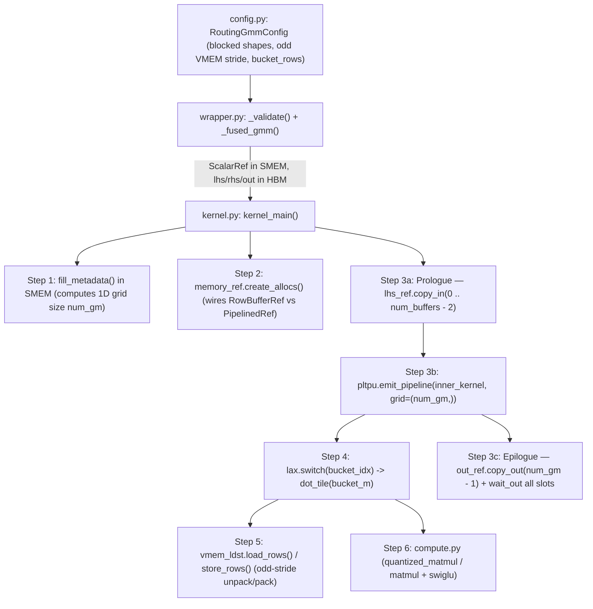

# Understanding the fused_routing_gmm Pallas kernel

I will use this post to explain the [fused_routing_gmm Pallas TPU kernel](TODO). You can find the unit tests in the same folder.


## 0. Why does this `fused_routing_gmm` kernel exist?

Previously, TPU inference ran a separate SparseCore Ragged Gather kernel to materialize the permuted [size_out_m, K] tensor in HBM before calling gmm_v2 (and a separate SparseCore Ragged Scatter after the second GMM). fused_routing_gmm eliminates that intermediate HBM buffer completely by issuing 1-row asynchronous DMAs directly inside the TensorCore Pallas GMM kernel!

Two Public Entry Points (wrapper.py):

1. fused_permute_gmm (GATHER)

  MoE Gate+Up Proj: Gathers rows from pool on-the-fly via 1-row DMAs → FP8/BF16 Matmul → Fused SwiGLU → writes contiguous expert-grouped rows.

2. fused_unpermute_gmm (SCATTER)

  MoE Down Proj: Reads contiguous expert-grouped rows → FP8/BF16 Matmul → scatters output rows via 1-row DMAs directly to scatter_indices slots!

## 1. Reference Implementation (What does the kernel do?)


Pure JAX Reference Implementation (wrapper_test.py)
```
# 1. Reference for fused_permute_gmm (RoutingMode.GATHER)
def ref_fused_permute_gmm(pool, rhs, rhs_scale, group_sizes, gather_indices):
  # Gather routed rows from the token pool: shape [size_out_m, K]
  routed_x = pool[gather_indices]
  out = jnp.empty((len(gather_indices), rhs.shape[-1] // 2), dtype=jnp.bfloat16)

  offset = 0
  for g in range(rhs.shape[0]):
    sz = group_sizes[g]
    # Dynamic 512-col blockwise FP8 matmul (or BF16 matmul if rhs_scale is None)
    acc = quantized_matmul(routed_x[offset : offset + sz], rhs[g], rhs_scale[g])
    # Fused SwiGLU: split [m, 2*N_out] into gate and up halves
    gate, up = jnp.split(acc, 2, axis=-1)
    out = out.at[offset : offset + sz].set(jax.nn.silu(gate) * up)
    offset += sz
  # Note: out[sum(group_sizes):] is left unwritten!
  return out

# 2. Reference for fused_unpermute_gmm (RoutingMode.SCATTER)
def ref_fused_unpermute_gmm(routed_lhs, rhs, rhs_scale, group_sizes, scatter_indices):
  out = jnp.empty((len(scatter_indices), rhs.shape[-1]), dtype=jnp.bfloat16)
  offset = 0
  for g in range(rhs.shape[0]):
    sz = group_sizes[g]
    y = matmul_or_quant_matmul(routed_lhs[offset : offset + sz], rhs[g], rhs_scale)
    # Scatter each result row i directly to out[scatter_indices[i]]
    out = out.at[scatter_indices[offset : offset + sz]].set(y)
    offset += sz
  return out
```

Actual Tile Math: Dynamic 512-Col FP8 Quantization & SwiGLU (compute.py)
```
def quantized_matmul(x: jax.Array, w: jax.Array, w_scale: jax.Array) -> jax.Array:
  size_k, dtype = x.shape[1], x.dtype
  quant_block_size = min(size_k, 512)  # 512-column LHS quantization block
  dtype_max = float(jnp.finfo(w.dtype).max)  # 448.0 for float8_e4m3fn
  rhs_scale = w_scale.reshape(1, -1).astype(dtype)
  acc = jnp.zeros((x.shape[0], w.shape[1]), dtype)

  for start_k in range(0, size_k, quant_block_size):
    end_k = start_k + quant_block_size
    block_lhs = x[:, start_k:end_k]
    # Per-row absmax scale for this 512-column block: [m, 1]
    block_scale = jnp.max(jnp.abs(block_lhs), axis=1, keepdims=True) / dtype_max
    # Safe zero guard: all-zero token row gets 0 instead of 1/0 = inf!
    block_scale_inv = jnp.where(block_scale == 0, 0, 1 / block_scale)
    block_lhs_q = (block_lhs * block_scale_inv).astype(w.dtype)  # cast to fp8
    block_acc = jnp.matmul(
        block_lhs_q, w[start_k:end_k, :], preferred_element_type=jnp.float32
    )
    acc += block_acc.astype(dtype) * rhs_scale * block_scale.astype(dtype)
  return acc

def swiglu(acc: jax.Array) -> jax.Array:
  gate, up = jnp.split(acc, 2, axis=-1)  # gate half first, then up half
  return jax.nn.silu(gate) * up
```

## 2. How Is the Inference Framework Supposed to Use It?

2.1 Crucial Layout Requirement


End-to-End Inference Recipe: All-Gather → fused_permute_gmm → fused_unpermute_gmm → Reduce-Scatter
```
# ==============================================================================
# INPUT FROM ATTENTION LAYER (sharded by DP = 8 across token axis):
#   x_dp:            bf16 [T // DP, K]       = [1024, 4096]
#   topk_indices_dp: int32[T // DP, topk]    = [1024, 10]   (values in 0 .. E - 1 = 0 .. 511)
#   topk_weights_dp: bf16 [T // DP, topk]    = [1024, 10]
#   w_gate_up_fp8:   fp8  [E // EP, K, 2*H]  = [64, 4096, 2048] (sharded by EP = 8)
#   w_down_fp8:      fp8  [E // EP, H, K]    = [64, 1024, 4096] (sharded by EP = 8)
# ==============================================================================

# Step 1: MoE Entry — All-Gather tokens & router decisions across DP (axis=0)
# Every chip now holds all T = 8192 global tokens and their top-k routing choices.
pool = jax.lax.all_gather(x_dp, axis_name="dp", axis=0, tiled=True)                 # bf16 [8192, 4096]
topk_indices = jax.lax.all_gather(topk_indices_dp, axis_name="dp", axis=0, tiled=True)  # int32[8192, 10]
topk_weights = jax.lax.all_gather(topk_weights_dp, axis_name="dp", axis=0, tiled=True)  # bf16 [8192, 10]

# Reshape global token pool into 4D blocked layout [T, K // 256, 2, 128]
pool_blocked = pool.reshape(T, K // 256, 2, 128)                                    # bf16 [8192, 16, 2, 128]

# Step 2: Local EP Routing & Counting Sort (M = T * topk = 81,920)
# Each chip (ep_rank = lax.axis_index("dp")) owns local experts [ep_start, ep_start + 64).
# Filter the M = 81,920 (token, topk_slot) pairs to keep ONLY those hitting this chip's 64 experts,
# and stable-sort them to the front (0 .. live_rows - 1) in local-expert order:
#   group_sizes:      int32[64]    -> count of routed rows per local expert (sum == live_rows)
#   gather_indices:   int32[81920] -> token index in [0, 8192) for each routed row
#   scatter_indices:  int32[81920] -> flat slot in [0, 81920) where each routed row belongs
#   local_valid_mask: bool [8192, 10, 1] -> True iff (t, k) was routed to THIS chip's local experts

# Step 3: Kernel 1 — Gate + Up Projection + SwiGLU (GATHER mode)
# Gathers `live_rows` from `pool_blocked`, multiplies by `w_gate_up_fp8`, applies SwiGLU.
# Output `routed_hidden` is ALREADY in 4D blocked layout [T * topk, H // 256, 2, 128]!
routed_hidden = wrapper.fused_permute_gmm(
    lhs=pool_blocked,            # bf16 [8192, 16, 2, 128]  (size_m = T)
    rhs=w_gate_up_fp8,           # fp8  [64, 4096, 2048]    (first 1024 = gate, last 1024 = up)
    rhs_scale=w_gate_up_scale,   # f32  [64, 1, 1, 2048]
    group_sizes=group_sizes,     # int32[64]
    gather_indices=gather_indices,
    tile_m=256,
    fuse_act="silu",
)  # -> returns bf16 [81920, 4, 2, 128] (only [:live_rows] written!)

# Step 4: Kernel 2 — Down Projection + HBM Scatter (SCATTER mode)
# Feeds `routed_hidden` directly (zero relayout!) into `fused_unpermute_gmm`.
# Multiplies [:live_rows] by `w_down_fp8` and scatters row i -> unpermuted_blocked[scatter_indices[i]].
unpermuted_blocked = wrapper.fused_unpermute_gmm(
    lhs=routed_hidden,           # bf16 [81920, 4, 2, 128]  (size_m = T * topk)
    rhs=w_down_fp8,              # fp8  [64, 1024, 4096]
    rhs_scale=w_down_scale,      # f32  [64, 1, 1, 4096]
    group_sizes=group_sizes,     # int32[64]
    scatter_indices=scatter_indices,
    tile_m=256,
    fuse_act=None,
)  # -> returns bf16 [81920, 16, 2, 128] (only scatter_indices[:live_rows] written!)

# Step 5: Local Masked Top-K Weighted Sum ([T * topk, K] -> [T, K])
# Unblock to [T, topk, K], zero out unwritten remote-expert slots, weight by `topk_weights`, sum over topk:
unpermuted_3d = unpermuted_blocked.reshape(T, topk, K)                              # bf16 [8192, 10, 4096]
masked_3d = jnp.where(local_valid_mask, unpermuted_3d, 0)                           # zero unwritten remote slots!
partial_moe_out = jnp.sum(masked_3d * topk_weights[:, :, None], axis=1)             # bf16 [8192, 4096] (partial sum)

# Step 6: MoE Exit — Reduce-Scatter across DP == EP (sums across chips + scatters T -> T // DP)
moe_out_dp = jax.lax.psum_scatter(
    partial_moe_out, axis_name="dp", scatter_dimension=0, tiled=True
)  # -> returns bf16 [T // DP, K] = [1024, 4096], ready for residual add & next Attention layer!
```


## 3. How the Kernel Works (Overview & Step-by-Step Explanation)

### Architectural Overview & File Map




---

### Step 1: Dynamic Tile Planning in SMEM (`fill_metadata` in `kernel.py`)

Different experts receive different numbers of routed rows (`group_sizes`), and some experts receive `0` rows. At the start of `kernel_main`, `fill_metadata()` runs a scalar `lax.fori_loop` in **SMEM** to split each non-empty group of `g` rows into `cdiv(g, tile_m)` tiles:

* **`gm_id_to_group_id[gm_id]`**: Which expert group `0 .. num_groups - 1` this tile belongs to.
* **`gm_id_to_m_offset[gm_id]`**: The first routed row index `0 .. size_out_m - 1` of this tile.
* **`gm_id_to_num_rows[gm_id]`**: How many valid rows (`1 .. tile_m`) this tile has: `min(end - offset, tile_m)`.
* **`num_gm[0]`**: Total number of active tiles across all groups (the 1D Pallas grid dimension `grid=(num_gm,)`).

#### Toy Example of `fill_metadata` (`tile_m = 4`, `group_sizes = [6, 0, 3]`)

With `group_cum_sum = [0, 6, 6, 9]`:

```text
Group 0 (6 rows: rows 0..5)  -->  cdiv(6, 4) = 2 tiles:
  - Tile gm_id = 0:  group_id = 0,  m_offset = 0,  num_rows = 4  (rows 0, 1, 2, 3)
  - Tile gm_id = 1:  group_id = 0,  m_offset = 4,  num_rows = 2  (rows 4, 5 — partial tile!)

Group 1 (0 rows: rows 6..6)  -->  cdiv(0, 4) = 0 tiles:
  - Completely skipped! Zero tiles emitted for empty groups.

Group 2 (3 rows: rows 6..8)  -->  cdiv(3, 4) = 1 tile:
  - Tile gm_id = 2:  group_id = 2,  m_offset = 6,  num_rows = 3  (rows 6, 7, 8 — starts at row 6!)

Total grid size: num_gm = 3 tiles.
```

---

### Step 2: One Kernel Body for Both Modes via Polymorphic `RowRef` (`memory_ref.py`)


**slots**: if don't understand how the slots work, keep reading Section 4.


### Step 3: The 3-Buffer Lookahead DMA Pipeline & Zero-Size DMA Trick (num_buffers = 3)


### Step 4: Dynamic M-Bucketing with lax.switch (config.py & kernel.py)


### Step 5: Odd-Block VMEM Padding (blocks | 1) & Register Unpacking (vmem_ldst.py)

Here are two hardware-level tricks in `config.py` and `vmem_ldst.py` that make reading/writing blocked rows in VMEM run at full VPU speed:

- Trick 5A: Why is buf_shape = (tile_m, blocks | 1, 2, 128) padded to an ODD block count?

- Trick 5B: How load_rows & store_rows Unpack/Pack 32-bit Words
```
def load_rows(ref: jax.Ref, rows: int, cols: int) -> jax.Array:
  dtype, stride, lanes = ref.dtype, ref.shape[1], ref.shape[-1]
  # View [rows, stride, 2, 128] bf16 as [rows * stride, 128] uint32
  words = ref.at[pl.ds(0, rows)].bitcast(jnp.uint32).reshape(-1, lanes)
  chunks = []
  for i in range(cols // (2 * lanes)):   # Only read real blocks (skip pad)
    for j in (0, 1):                     # j=0: low 16b, j=1: high 16b
      chunk = pltpu.unpack_elementwise(
          words[i::stride], index=j,
          packed_dtype=dtype, unpacked_dtype=jnp.float32,
      )
      chunks.append(chunk.astype(dtype)) # [rows, 128] bf16
  return jnp.concat(chunks, axis=-1)     # -> [rows, cols] bf16!
```

## Section 4 · Interactive Walkthrough

**Step-by-Step 3-Buffer DMA & Compute Pipeline Simulator**

Step through the execution of kernel_main on a 4-tile grid (num_gm = 4, num_buffers = 3) to see how the 3 VMEM slots (Slot 0, Slot 1, Slot 2) overlap per-row DMAs with MXU compute.


